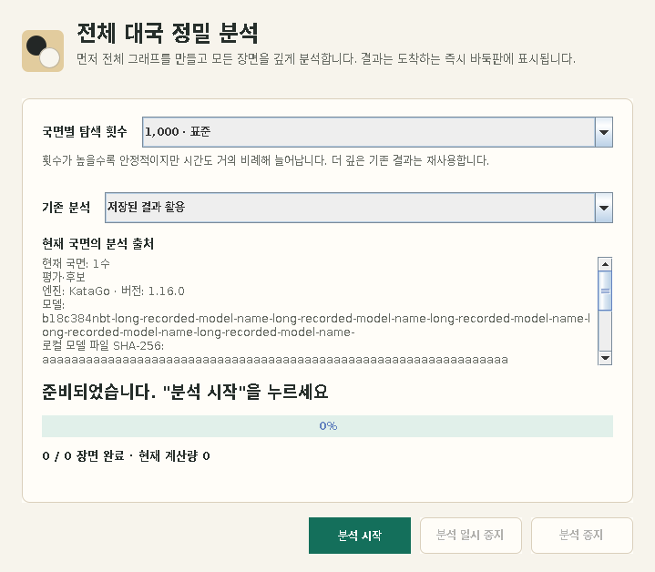

# Analysis provenance and reassessment

Whole-game analysis distinguishes the result currently available for display
from the work requested by the user. Provenance describes a saved result. It is
not, by itself, permission to count that result as completed work in a new run.

## User choices and display

The whole-game analysis dialog offers two policies under **기존 분석**:

| Choice | Behavior |
| --- | --- |
| **저장된 결과 활용** (`REUSE_SAVED`, default) | Reuse a complete, valid saved result when it meets the requested visits and ownership requirements. A missing source record does not delete or disqualify otherwise reusable legacy analysis. |
| **현재 엔진으로 다시 평가** (`REEVALUATE_CURRENT_ENGINE`) | Request fresh results for the positions in the whole-game main-line plan using the current engine and its rules. Existing visits do not satisfy the new run until that run has published a qualifying result. |

Reassessment retains the previous evaluation, candidates and ownership for
display while replacement work is pending. A newly accepted result replaces
the relevant payload, even when the older result had more visits. Cancelling
does not erase positions that have not received a replacement, and does not
roll back fresh results already accepted. A pause/resume within the same plan
keeps its run identity; starting another reassessment creates a new identity.

The **현재 국면의 분석 출처** panel describes the primary analysis of the
position currently displayed on the board. It follows board navigation and
payload updates. It is not an assertion that every position in the game has
the same producer. Evaluation/candidates and the ownership map have separate
source records: a lower-visit ownership backfill may update the map while a
stronger existing evaluation remains visible. If the two records are equal,
the panel says that the same source information was recorded; this does not
establish equality of all unrecorded engine settings.

An old SGF can show **분석 출처 미확인** alongside its legacy engine display
label. A configured display name such as “My strongest engine” is not treated
as a model identity. Unknown values are displayed as **미확인**, including
individual missing fields in an otherwise useful source record.



Example captured from the desktop regression fixture. The engine/model details
and repeated-character hash are test values. Long source details remain
scrollable while the analysis controls stay visible.

## Meaning of recorded fields

`featurecat.lizzie.analysis.AnalysisProvenance` is an immutable value with ten
fields. Empty text and null numbers mean unknown. Numeric fields must be
finite. The runtime collector normalizes invalid or oversized optional values
to unknown so that missing metadata cannot stop analysis publication.

| Field | What it records |
| --- | --- |
| `engineName` | An engine/connection name actually reported through the supported protocol path. It is separate from the user-configured display label. |
| `engineVersion` | The version reported by that producer or adapter. An adapter's version does not establish the version of an unseen remote server. |
| `modelName` | A model identifier available from a local model file or an explicitly known remote model identifier. |
| `modelSha256` | SHA-256 of the actual local model file observed for the launch. For a `.bin.gz` input, this identifies the compressed file bytes. |
| `configSha256` | SHA-256 of an unambiguous local configuration file observed for the launch. It does not describe every effective setting, included file or runtime override. |
| `rules` | Rules known for the accepted stream or dispatched analysis request. |
| `komi` | Komi known for that stream or request. |
| `pda` | Observed static playout doubling advantage, when available. An unobserved or dynamic value remains unknown. |
| `wrn` | Observed analysis wide root noise, when available. |
| `humanSLProfile` | The HumanSL profile when it is explicitly known. Current live collection leaves this field unknown. |

Local file hashes are file observations, **not attestations that the engine
loaded those exact bytes**. A process could already have loaded a previous
file, a wrapper could choose a different input, or a remote server could use
another model. The UI therefore labels the model hash as a local model file
SHA-256. The model/configuration lookup runs outside the payload-publication
lock and does not block the engine reader. An early result may retain unknown
file identity when the background lookup has not completed.

The collector preserves uncertainty:

- Remote connections do not borrow a similarly named file from the local
  filesystem. A known remote model identifier may be recorded without a hash.
- Indirect launch commands, unavailable files and ambiguous model inputs may
  leave identity unknown. Multiple configuration inputs are not represented
  by the hash of whichever path appeared last.
- A configuration hash does not expand include files or prove the effective
  combination of configuration, command-line options and runtime parameters.
- Missing engine/version responses, unobserved conditions and HumanSL profile
  state are not inferred from the current global engine or the legacy SGF
  label. A request can have known rules/komi while producer details remain
  unknown.

The default reuse policy does not perform an automatic “same configuration”
decision from these partial observations. Users select reassessment when they
want every planned position evaluated again by the current engine.

## Payload ownership and lifecycle

`BoardData` stores four independent provenance slots:

- `primaryAnalysisProvenance()` and `primaryOwnershipProvenance()`;
- `secondaryAnalysisProvenance()` and `secondaryOwnershipProvenance()`.

An accepted full payload assigns evaluation provenance from its explicit
engine/request owner. A rejected payload changes neither result nor source.
An ownership-only update changes only ownership provenance. If a full update
retains an existing ownership map, it also retains that map's original source.
A generic import without an explicit producer clears the replaced source
instead of borrowing `Lizzie.leelaz`.

Clone, sync, analysis-payload copy and setup-snapshot transfer preserve these
immutable source values along with the result. Full payload clearing removes
the corresponding sources. The existing “clear information” actions retain
the ownership map; their shared `BoardData` helpers remove evaluation values
and evaluation provenance while keeping ownership values and provenance.

Saved payload state and live execution permissions must remain separate:

| State | Scope |
| --- | --- |
| Persisted `AnalysisProvenance` values | Explain the displayed/saved payload; copied with it and serialized to SGF. |
| Persisted `isChanged` / `isChanged2` flags | Mark the corresponding saved payload as invalidated; retain it for display while excluding primary analysis from reuse. A fresh accepted replacement clears that slot's invalidation. |
| Existing live `analysisSource` identity | Admits ordinary output from the current stream; not a durable source record. |
| `primaryAnalysisRun` object identity | Allows a fresh result to satisfy one explicit reassessment plan; never serialized or inherited by copies. |
| `primaryAnalysisRevision` counter | Invalidates already dispatched work when the live position changes; never restored from SGF. |

`hasReusablePrimaryAnalysis(visits, ownership, requiredRunToken)` applies the
usual completeness/invalidation checks and, when the token is non-null,
requires a result marked by that run. A null token retains the default reuse
behavior. Full replacement clears the old token; the request owner marks the
accepted result with its own token. Copy/sync and clear boundaries remove the
token. Updating an already accepted result's exact root visit count with
`setPlayouts` must not silently remove that token. Provenance equality never
substitutes for these admission and completion checks.

## SGF format and compatibility

Root analysis uses `LZOP`/`LZOP2`; other nodes use `LZ`/`LZ2`. The six legacy
header slots retain their positions. A known evaluation WRN is also written
as the optional named extension `wrn=<number>` after those slots, alongside
`rootVisits` when known. Short headers are padded before a named WRN; padding
does not invent a root visit count. Readers without this extension still read
the legacy analysis payload.

The named WRN extension accepts finite values from **0 through 5**, matching
KataGo's `analysisWideRootNoise` range, rather than the GUI editor's narrower
0 through 2 range. Zero is known, not absent. Malformed, out-of-range or
duplicate WRN extensions are treated as unknown without discarding the
evaluation, candidates or ownership values. Other named extensions are ignored.
See the engine's [GTP parameter loading](https://github.com/22nsuk/KataGo/blob/8463d80da8ecdeb86a30ab76df93dde8b4b0186b/cpp/command/gtp.cpp#L2139-L2140).

WRN in generated primary/secondary, game and engine-game summaries comes from
the corresponding evaluation provenance, not the current engine's editable
settings or the ownership source. Known zero is displayed; unknown is omitted.
The existing source panel continues to distinguish known zero from unknown.

Provenance and invalidation state are
stored separately in a custom **`KGP`** property, as UTF-8 JSON encoded with
unpadded Base64URL. This keeps model names, Unicode, brackets and backslashes
outside the legacy analysis/PV grammar.

The reader accepts versions 1 and 2. The writer uses version 2 when a serialized
payload is invalidated, including when its provenance is unknown. Valid-only
source records continue to use version 1 so existing v1 readers can display
their provenance. Version 2 adds a per-slot `invalidated` Boolean; absent flags
and version 1 retain legacy validity behavior.

The decoded structure is:

```text
app: "KG-next"
version: 1 or 2
primary?:
  payloadSha256: SHA-256 of the primary LZ/LZOP property value
  analysis?: AnalysisProvenance object
  ownership?: AnalysisProvenance object
  invalidated?: Boolean (version 2 only)
secondary?:
  payloadSha256: SHA-256 of the secondary LZ2/LZOP2 property value
  analysis?: AnalysisProvenance object
  ownership?: AnalysisProvenance object
  invalidated?: Boolean (version 2 only)
```

The hash input is the unescaped SGF property value encoded in UTF-8, including
the header, newlines, candidate detail and ownership text. The save path
generates the payload and its metadata together under the node's publication
lock. The parser hashes the original imported value before suggestion/PV
limits can change its in-memory representation. These import digests are
temporary parser bookkeeping, copied where a setup snapshot needs them; they
are not an additional SGF property.

The live, detached and branch parsers remove SGF escape backslashes once from
`LZ`, `LZOP`, `LZ2` and `LZOP2` while reading the property. Engine names containing
`]`, literal backslashes or a literal backslash followed by `n` therefore retain
their saved text and match the same payload digest after reopening. This does
not change the existing escaped-newline convention or the raw escape handling
of opaque `KGP` and unrelated properties. The reader does not repeatedly
unescape names from older resaved files or guess at missing provenance: extra
literal backslashes may be intentional, and previously discarded metadata is
not recoverable from the analysis text alone.

`KGP` can appear before or after the corresponding legacy properties. The
three parser entrypoints route it through the same pending setup-metadata
handling as analysis, so sources and invalidation follow the correct move or
setup snapshot. Primary and secondary payload hashes are checked independently.
Replacing `KGP` replaces the whole provenance record, but restores invalidation
only for payload slots replaced in the current parser call. Importing one
legacy analysis property, with or without `KGP`, preserves the other slot's live
invalidation even when its old payload hash matches the incoming metadata.
Metadata alone cannot override live invalidation. This import scope follows
payloads transferred to setup snapshots and ends when parsing returns; it is
not retained on the board or reused by a later import.

A matching KGP source takes precedence over a named WRN, including when that
source's WRN is explicitly unknown. The original header WRN is retained with
its import digest so that a later invalid or nonmatching KGP replacement can
fall back to the header, not to the previously applied KGP value. Payload
replacement and clearing retire that fallback together with the digest.
KGP keeps its existing finite-number schema; it is not narrowed to the named
extension's range. A recorded KGP value outside that range remains in KGP and
is not emitted as a named WRN extension.

A header-only WRN supplies only that parameter: it does not establish the
engine, model, rules, komi, PDA or ownership producer. When there is no richer
source, ownership provenance or invalidation state to save, this partial
source is written in the header without creating a new KGP. In particular,
reading it does not by itself replace opaque/future KGP data. A slot that also
needs ownership provenance or invalidation metadata keeps its partial
evaluation source in KGP as well, preserving both on reopen.

If an older client keeps `KGP` but replaces an `LZ` value, the mismatching slot
does not inherit the rejected source identity or the old payload's invalidation
flag. A valid header WRN can still supply that one parameter. The evaluation
remains usable and visible.
This binding detects obsolete metadata; it is not a signature or proof that
an SGF author supplied truthful engine information.

The decoder requires the expected application/version, allowed field names,
valid field types, finite numbers, strict Boolean invalidation flags and
64-character hexadecimal hashes. Text limits are 1,024 characters for
engine/model names, 128 for engine version,
8,192 for rules and 256 for HumanSL profile. The encoded property is limited
to 393,216 characters (384 KiB) for decoding. Each of the four source records
accepts at most 10,752 UTF-16 text units, including the two hashes. Allowing
six JSON bytes per unit and 2,048 bytes for field names, punctuation, payload
hashes and finite numbers bounds generated JSON at 260,096 bytes and padded
Base64 at 346,796 characters. The decoding limit therefore accommodates all
accepted source records even with maximum JSON escaping. Invalid UTF-8,
malformed metadata and unsupported versions are ignored as analysis metadata
without rejecting the legacy analysis.

Opaque or unsupported raw `KGP` values are retained when possible and written
back when no current source or invalidation record supersedes them. A live
payload replacement or information clear discards obsolete opaque metadata
rather than guessing how to update a future schema. Recognized metadata is regenerated from the current
slot state against the newly serialized payload, or omitted when no source or
invalidation remains. This prevents a previously rejected digest from matching
again merely because saving normalizes the payload text. An analysis-free/raw
export follows the existing analysis-export policy and need not retain provenance.

Old SGFs without `KGP` require no migration. Their analysis loads as before,
with unknown source except for a valid named WRN when present. Clients that
do not understand this optional property
can continue to use the legacy payloads; clients that strip unknown properties
will also strip provenance and invalidation. Older clients cannot enforce the
version 2 invalidation state and may show its payload as valid; their v1-only
reader also treats v2 source records as unknown. Invalidation that was already
lost when saving in an older version cannot be reconstructed from visits or
source records alone.

## Validation entrypoints

Run from the repository root with the project's supported JDK and Maven.
These are verification commands and coverage descriptions, not a record that
any particular checkout has passed them.

```sh
# Payload ownership, source preservation, SGF parser/setup/legacy compatibility
mvn -B -Dfmt.skip=true -Djava.awt.headless=true \
  -Dtest=AnalysisWrnSgfTest,AnalysisInvalidationSgfTest,AnalysisProvenanceSgfTest,BoardDataAnalysisProvenanceTest,SGFParserSemanticRoundTripTest,BoardNodeKindHistoryPipelineTest,BoardDataAnalysisCacheTraceTest test

# Reuse/reassessment planning, request publication, identity capture and display
mvn -B -Dfmt.skip=true -Djava.awt.headless=true \
  -Dtest=WholeGameAnalysisOptionsTest,WholeGameAnalysisPlanTest,WholeGameAnalysisSessionTest,AnalysisEngineRequestTest,AnalysisModelIdentityTest,LeelazOrdinaryResponseSettlementTest,AnalysisProvenanceDisplayTest test

# Project-wide unit/integration checks and package validation
mvn -B -Djava.awt.headless=true verify
```

`AnalysisProvenanceSgfTest` covers separate evaluation/ownership sources,
root/move/setup round trips, all three parser entrypoints, property ordering,
legacy files, payload changes, suggestion limits, maximum-length escaped source
records, malformed/future/oversized metadata, strict invalidation flags and exact
serialized digests. It also covers slot-specific imports and prevents recognized
metadata from reviving after payload normalization. `AnalysisInvalidationSgfTest`
covers repeated save/reopen, independent slot validity, subtree invalidation,
the real whole-game reuse plan and snapshot/file-save entrypoints while retaining
the previous displayed result.
`BoardDataAnalysisProvenanceTest` covers full,
rejected and ownership-only adoption, retained maps, explicit producer
ownership, copy/sync/clear boundaries and nonpersistent run permission.

Desktop checks should also open the whole-game dialog, navigate between
positions with different sources, inspect long/unknown source values, select
each reuse policy and cancel during reassessment. Headless storage and request
tests do not establish desktop layout or native engine behavior on every
platform. Report those checks separately in the PR that performs them.
