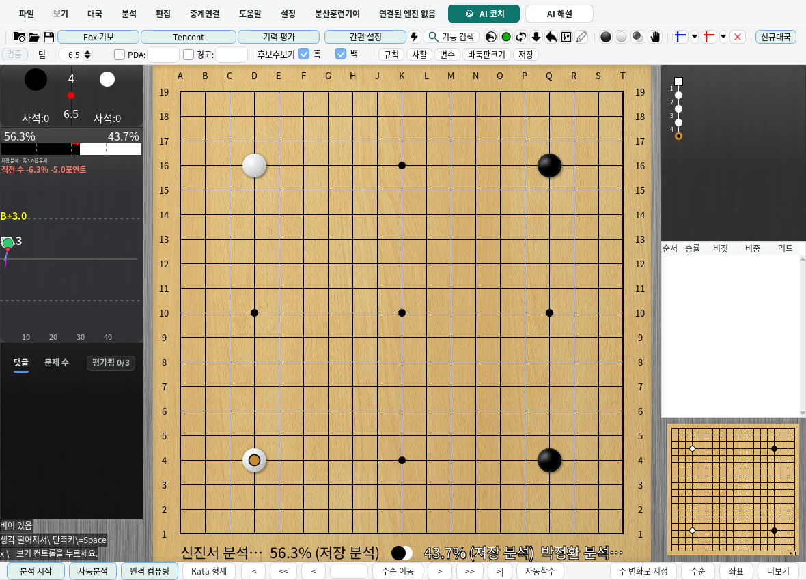
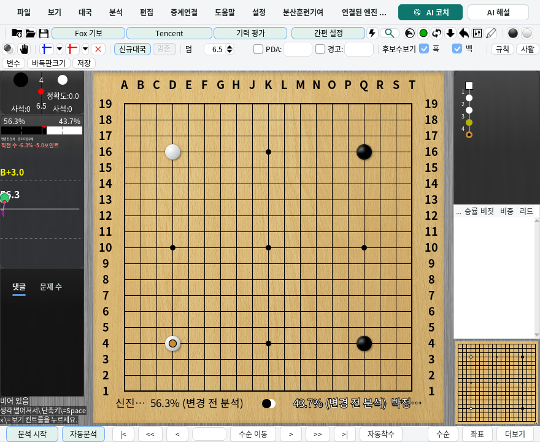
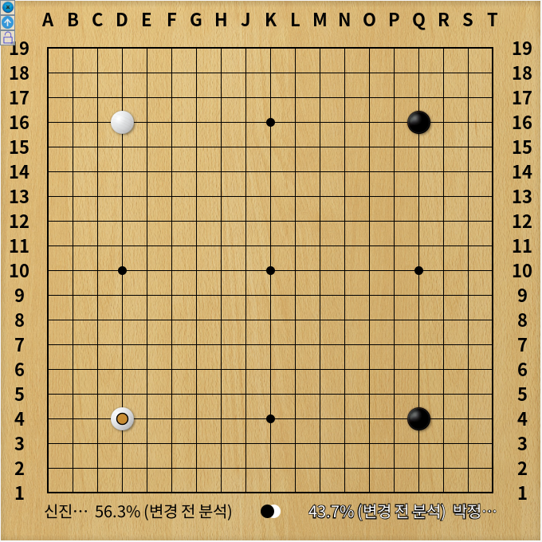

# Analysis readability

The line below the winrate bar emphasizes the **previous move's change** with bold text.
Positive changes use green and negative changes use red; the signed values remain visible.
When score changes are available, their sign determines the emphasis color. Otherwise the
winrate change determines it. A change displayed as `0.0` keeps the ordinary text color.

The previous-move text can grow to 1.5 times the ordinary size limit when the row has enough
height and width. Narrow panels use separate lines for the lead/source and the previous move
within the existing statistics area, using a slightly shorter winrate bar to keep the text legible.
This does not change the application's font setting, coordinate font, or outer panel geometry.

## Winrates beside names

Enable **View → Main panel settings → Show winrates beside player names**, or click the
name strip below the board. Function search can locate the same menu checkbox. The option
starts off and is saved after a successful configuration write. If saving fails, the application
reports the error and keeps the previous choice.

- Black's percentage follows the black name; White's percentage precedes the white name.
- The main board and independent main board read the primary analysis slot. The comparison
  board reads its own secondary slot.
- Both percentages describe the position displayed by that board. The rounded values add
  up to `100.0%`, including halfway rounding cases.
- Long names are abbreviated after reserving space for percentages, source labels and
  live engine-game match scores. The font also adapts to retain an identifiable name prefix. Existing Korean font selection and turn stones remain.
- Clicking the name strip toggles only this display choice. It does not play a move, including
  through the manual input route used during an engine game.
- When names are hidden, empty, or replaced by setup/heat-map presentation, their former
  clickable area is cleared. The existing **Show name in board** option still controls whether
  the strip itself is displayed.

## What a displayed value means

| Display | Meaning |
| --- | --- |
| Percentage with no source suffix | Analysis stored for this position; not proof that the current engine can reuse it. |
| **Saved analysis** | Analysis loaded with a sufficiently complete saved analysis header. |
| **Retained analysis** | An earlier result preserved for display after analysis reuse was invalidated. |
| **Earlier position (move N)** in the statistics row | A temporary reference from an earlier position when the selected position has no displayable analysis. |
| `--` beside a name | No displayable analysis for this position and this engine slot. |
| **No analysis** in the statistics row | Neither the selected position nor its limited previous-position fallback has displayable analysis. |

The name strip never substitutes an earlier position's percentage. The statistics panel retains
its existing limited fallback, but labels its move explicitly. An earlier-position fallback cannot
produce a fabricated previous-move change. Visits alone, the default 50%, non-finite values and
out-of-range percentages are not analysis payloads. Saved and retained payloads remain visible;
display eligibility is separate from engine-reuse eligibility.

The existing score and winrate perspective calculations remain authoritative. Engine games
retain their own-engine comparison, sometimes two moves apart, with gain/loss expressed for
the side that just played. The arrow points toward the new black-winrate boundary, including
same-turn setup positions.

## Implementation and verification

This selectively adapts [upstream PR #736](https://github.com/wimi321/lizzieyzy-next/pull/736)
and [PR #730](https://github.com/wimi321/lizzieyzy-next/pull/730). It retains KG-next's payload,
score-perspective and transactional configuration rules. It does not add a separate broadcast
window or an additional persistent font-size setting.

Focused tests cover missing payloads, saved and invalidated analysis, primary/secondary slot
ownership, previous-position fallback, percentage rounding, score and winrate perspectives,
atomic setting publication on save failure, long multilingual names, Unicode truncation,
and row clipping at ordinary and simulated 2× rendering scales. Existing coordinate and
analysis-provenance regression tests remain applicable.

```bash
mvn -B -Dfmt.skip=true -Djava.awt.headless=true \
  -Dtest=WinrateReadingTest,MoveStatusLineTest,BoardNamePlateTest,MoveStatusTextTest,BoardRendererKoreanNameTest,BoardCoordinateStyleTest,MainWindowTitleTest,AnalysisProvenanceDisplayTest,BoardDataAnalysisProvenanceTest,FunctionSearchTest,LocalizationResourceParityTest test
```

`AnalysisReadabilityDesktopTest` starts the production application with an isolated profile and
deterministic analysis payloads. It exercises Korean main and independent windows, real input
listeners, the engine-game manual route, function-search/menu wiring, persisted display choice,
long names, a resized window, 200% bold coordinates, hidden/setup hitbox invalidation, and
rendered arrow direction/color. It also renders the comparison name strip to verify that primary
slot updates cannot change its percentages. The desktop lane requires this test to run without
skipping.

```bash
mvn -B -Dfmt.skip=true -Djava.awt.headless=false -Dlizzie.desktop.required=true \
  -Dtest=AnalysisReadabilityDesktopTest test
```

These checks do not run a real KataGo model, GPU, Windows/macOS desktop, or physical HiDPI
display. The screenshots below are Linux Swing captures using controlled saved analysis.






