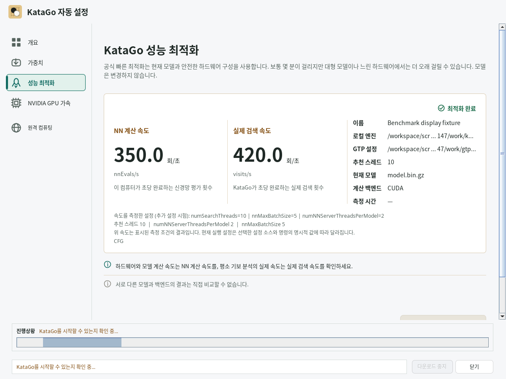
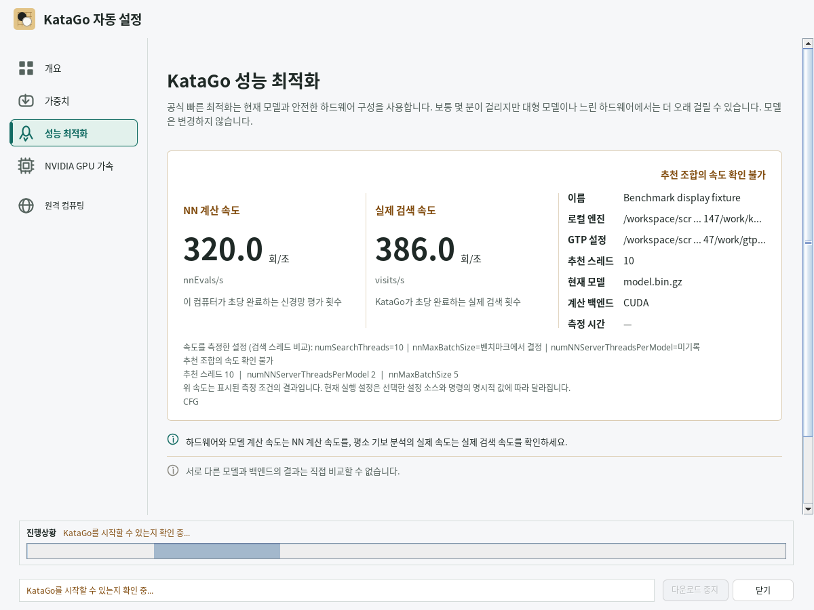
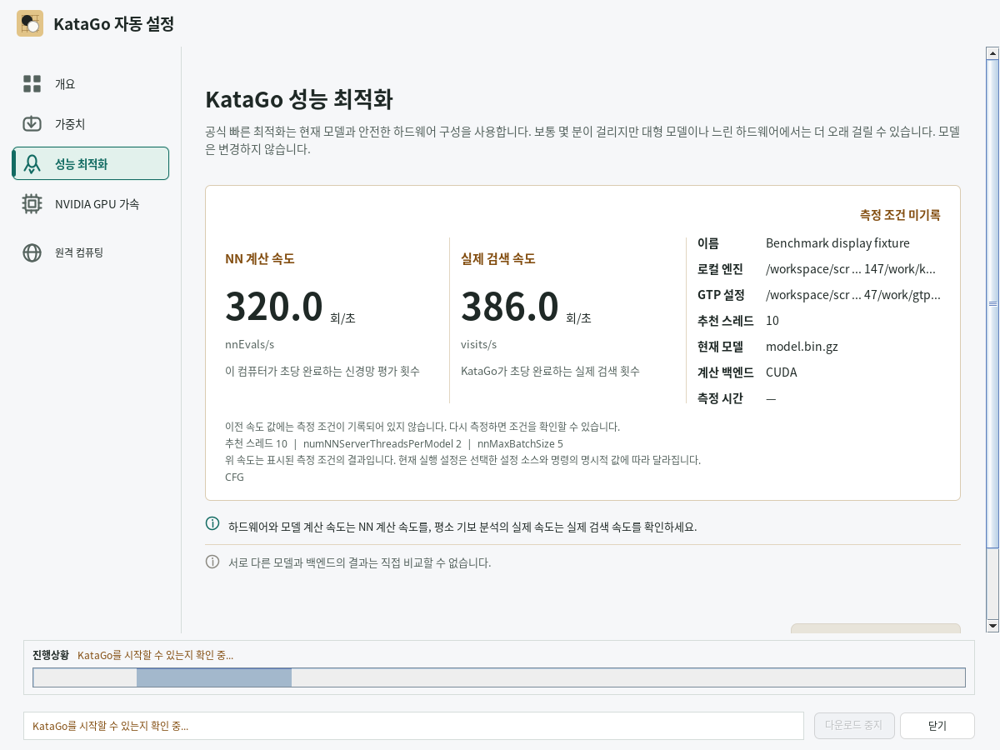

# Benchmark speeds and measured settings

The performance card identifies the settings that produced its speed values. A
recommendation and the currently selected launch settings can differ from those
measurement settings.

## Which measurement is shown?

| KataGo output | Speed and settings displayed |
| --- | --- |
| Search-thread comparison only | The complete original row for the recommended search-thread count. Batch size is benchmark-controlled; the NN-server count is unreported. |
| Two NN servers per GPU accepted, smaller batch rejected | The complete NN-server trial row, with the final **total** server count and benchmark-controlled batch size. |
| Smaller batch accepted | The complete batch trial row, with its tested batch size and the preceding accepted NN-server recommendation, if reported. |
| Extra trial missing, incomplete, nonfinite, or inconsistent with the final recommendation | The original search-thread row, with a warning that the recommended combination's speed is unverified. |
| Older saved result without measurement metadata | The saved values remain visible, labelled as having no recorded measurement settings. |

KataGo chooses the batch size during its ordinary search-thread sweep. The app does
not read today's `gtp.cfg` and label that value as a historical measurement. An
unreported server count is also not converted into an assumed count of one.
Percent improvement messages do not supply substitute throughput values.

Accepted additional trials are kept separate from the original search table.
Existing thread selectors continue to use that table. Official Apple optimization
also keeps its original search-row measurement; the optional fixed GPU/ANE search
records the selected candidate's known thread, server and batch values.

## Saved results and current execution

The engine entry stores `katago-benchmark-measured-settings` alongside the speed
values, containing `searchThreads`, `nnServerThreadsPerModel`, `maxBatchSize`, and
`source`, plus whether additional per-thread GPU device mapping was required.
Missing or invalid metadata remains unknown. A later result without a
complete measurement removes the preceding measurement metadata.

The result card and completion message show both the measured settings and the
recommendation. Selecting CFG or supplying explicit command overrides still
controls execution as before. Old results do not trigger an automatic rerun merely
because their measurement settings are unknown.

The pre-analysis time estimate uses a GTP benchmark reference only when the saved
environment and all three explicit effective launch settings match known measured
values. Unknown defaults, changed settings, extra trials requiring per-thread GPU
device advice (including an explicitly selected single GPU), and experimental Metal
candidates whose device mapping is not established by this metadata use the existing
unknown-estimate path. A retained estimate remains approximate: whole-game analysis
can use a separate analysis configuration and different positions.

## Verification and screenshots

`KataGoBenchmarkParserTest` covers all four extra-trial decisions, missing and
invalid evidence, and a multi-GPU total server count. The persistence tests run a
controlled local process through benchmark application and reload, exercise CFG
and explicit overrides, and verify the official Apple reconstruction path. The
fixture's 386.0, 401.0 and 420.0 values are test data, not hardware performance claims.

Run the production Swing card checks on an operational desktop with:

```sh
mvn -B -Dfmt.skip=true -Djava.awt.headless=false -Dlizzie.desktop.required=true \
  -Dtest=BenchmarkMeasurementDesktopTest test
```

The probe covers Korean, English and Simplified Chinese, fresh-completion states,
recorded/unknown/unmatched settings, accessible descriptions, and wrapped text at
the configured UI scales of 1 and 1.5. Both cases are required by the desktop CI
runner; a skipped or missing invocation fails its evidence check. It saves screenshots under
`target/desktop-smoke/probes/benchmark-settings-*`. The mock engine is not launched
for these UI checks; the screenshots' engine inspection indicator is fixture state.

### Complete additional-trial measurement



### Original measurement with an unverified recommendation



### Older record with unknown measurement settings


