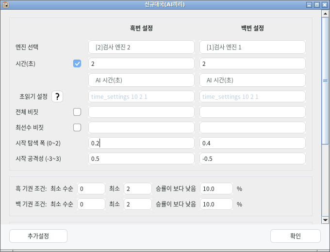
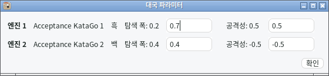

# 엔진 대국의 탐색 폭·공격성 설정

**분석 모드의 엔진 대국**에서 엔진 1과 엔진 2의 탐색 폭(WRN)과 공격성(PDA)을 각각 설정할 수 있습니다. 값을 입력하면 두 엔진의 확인 응답을 받은 뒤 대국을 진행합니다.

## 대국 시작값

새 엔진 대국 창에서 각 위치의 값을 입력합니다.

| 항목 | KataGo 파라미터 | 범위 | 최초 기본값 |
| --- | --- | --- | --- |
| 탐색 폭 | `analysisWideRootNoise` | 0–2 | 0 |
| 공격성 | `playoutDoublingAdvantage` | −3–3 | 0 |

값은 **엔진 1·엔진 2 위치**에 저장됩니다. 해당 위치의 엔진을 바꾸거나 배치 중 흑백을 교대해도 위치별 값은 유지됩니다. 예전 설정 파일에는 새 항목이 없으므로 0에서 시작합니다. 엔진 대국 전용의 기존 ‘탐색 폭 끄기’ 대신 탐색 폭에 0을 지정합니다.

각 대국을 시작하기 전에 엔진에 값을 설정하고 다시 읽어 실제 적용을 확인합니다. 배치의 다음 대국은 시작할 때 정한 값으로 돌아갑니다.

위 화면은 시작값 입력 검사의 실제 실행 화면입니다. 흑백 위치별로 탐색 폭과 공격성을 독립적으로 지정합니다.

## 대국 중 변경

상단 도구 모음 또는 **대국 → 대국 파라미터**를 엽니다. 도구 모음을 메뉴에 합치거나 숨긴 경우에도 대국 메뉴에서 접근할 수 있습니다.

창에는 각 위치의 엔진·현재 돌 색·확인된 값이 표시됩니다. 수정한 항목만 전송하며, **확인**을 누르면 선택한 항목의 응답을 모두 확인한 뒤 창이 닫힙니다. 확인 중에는 중복 확인이나 입력으로 진행 중인 요청을 바꿀 수 없습니다. Esc 또는 창 닫기는 입력값을 새로 전송하지 않습니다.

실제 CPU KataGo 두 개를 사용한 검사 화면입니다. 엔진 1의 확인된 탐색 폭은 0.2이고, 입력한 0.7은 **확인**을 누르면 적용됩니다.

거절·시간 초과·프로세스 교체 등으로 확인하지 못하면 이유를 표시하고 대국을 일시정지합니다. 설정 불일치가 해소되기 전에는 일반 **계속**으로 대국을 재개할 수 없습니다. 값을 수정해 다시 확인한 후 재개하세요. 변경 전에 사용자가 일시정지한 대국은 확인이 끝나도 일시정지를 유지합니다.

대국 중 변경은 **현재 대국에만 적용**됩니다. 다음 대국의 시작값이나 일반 분석 설정을 덮어쓰지 않습니다. 분석 모드 대국이 파라미터를 관리하는 동안 일반 도구 모음과 고급 엔진 설정의 WRN/PDA 직접 편집은 잠기며, 표시·자동 불러오기 선호 설정은 계속 저장할 수 있습니다.

## 종료와 복원

첫 대국의 값을 적용하기 전에 두 엔진 프로세스의 원래 WRN/PDA 값과 설정 유무를 함께 보관합니다. PDA를 설정하지 않은 자동 모드와 명시적으로 0을 설정한 정적 모드를 구분하며, 동적 PDA 설정은 그대로 유지합니다. 배치가 끝나거나 사용자가 중지하면 **같은 프로세스**에 원래 값과 설정 유무를 돌려놓고 다시 확인합니다. 원래 없던 설정은 삭제하고, 명시되어 있던 설정은 원래 값으로 복원합니다. 두 엔진의 복원이 확인될 때까지 일반 분석과 파라미터 직접 변경은 잠깁니다. 배치 사이의 흑백 교대에서는 원래 값으로 복원하지 않습니다.

기보 저장 실패는 기존 재시도 흐름을 유지합니다. 대국 소유자의 종료가 완료된 뒤 설정을 복원하며, 배치 중지를 이유로 저장하지 못한 기보를 버리지 않습니다. 복원할 수 없는 프로세스는 종료하고 실패를 알립니다. 이미 교체된 새 프로세스에는 이전 프로세스의 값을 쓰지 않습니다.

## 엔진별 지원

분석 대국에는 **KataGo 1.18.2 이상이면서 `kata-get-param-state` 상태 조회를 지원하는 빌드**가 필요합니다. 두 참가자의 버전과 전체 상태를 쓰기 전에 확인하므로, 구형 엔진 또는 상태 조회를 지원하지 않는 빌드는 시작을 거절합니다. 기존 공식 1.18.2 및 이전 KG-next 번들 엔진에는 이 확장이 없으며, 해당 계약을 추가한 [KG-next용 KataGo](https://github.com/22nsuk/KataGo/commit/57677bab9dc1db7d993eccd9f26b0e5ac0ed5570) 빌드로 교체해야 합니다. 버전 번호만 같다고 지원되는 것은 아닙니다.

지원되는 일반 KataGo는 두 항목을 지원합니다. 비 KataGo 엔진은 두 항목을, 전용 PDA 전략을 가진 `KataGoPda` 또는 동적 PDA 엔진은 공격성을 이 기능으로 변경하지 않습니다. 지원하지 않는 항목의 시작값 0은 기존 전략을 유지하는 뜻이며, 0 이외의 값을 지정하면 시작을 거절합니다.

이 기능은 분석 모드 엔진 대국에 적용됩니다. `genmove` 대국은 기존 WRN 잠금을 유지하며, 기존 고급 설정의 PDA 편집과 전용 `KataGoPda` 참가자 설정을 계속 사용할 수 있습니다. 사람과의 대국, Fox·ReadBoard의 파라미터 처리는 각 기능의 기존 설정을 따릅니다.

원격 Analysis API 연결은 KG-next 어댑터가 매 요청에 명시적인 값을 넣으므로, 어댑터가 보관한 정확한 값을 같은 상태 조회·복원 계약으로 처리합니다. 어댑터의 버전 응답은 원격 서버의 실제 버전이 아닌 구현된 GTP 호환 계약을 나타냅니다.
