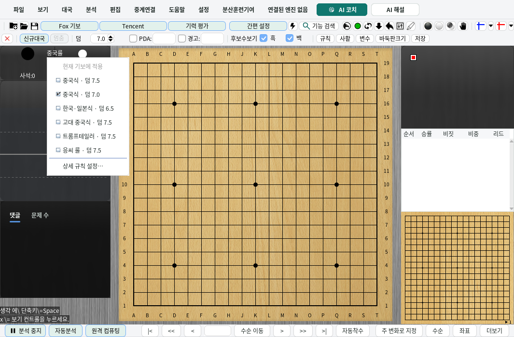
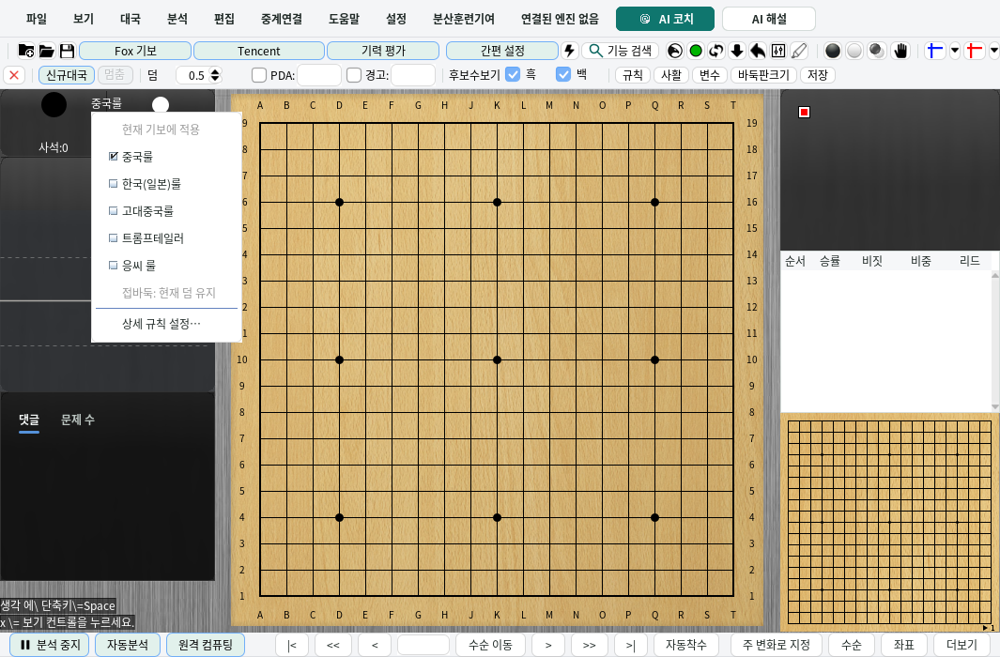

# Quick rules and komi switching

Click the rules caption in the main window's information panel to open the preset menu.
Choose a preset to change the **current game**. **More rules settings…** opens the existing
KataGo rules editor, including its separate startup-default preference.

| Choice | KataGo rules | Komi in an even game |
| --- | --- | ---: |
| Chinese | `chinese` | 7.5 |
| Chinese | `chinese` | 7.0 |
| Japanese / Korean | `japanese` | 6.5 |
| Ancient Chinese | `stone-scoring` | 7.5 |
| Tromp–Taylor | `tromp-taylor` | 7.5 |
| Ing (GOE) | `goe` | 7.5 |

The Chinese choices identify the exact engine settings. They do not claim support for every
provision or tie-break procedure of a particular year's competition regulations.

## Scope and display

- The menu does not alter new-game komi, engine profiles, or saved startup rules, even when
  automatic startup rules are enabled. Loading a game does not automatically select a preset.
- In a handicap game, the menu applies rules only and keeps the current komi. It omits the
  duplicate Chinese choice and labels the entries without a replacement komi.
- A check mark requires the exact confirmed preset rules and, in an even game, its komi.
  Similar display families such as `chinese-ogs`, unknown readbacks, and custom parameters
  do not receive a misleading check mark. The caption labels custom rules as **Custom**.
- Running and recorded engine games retain their existing rules-detail view. Engine-game
  admission, whole-game analysis, unavailable engines and non-KataGo engines retain the
  rules editor's entry restrictions.
- The action rechecks its captured game and engine when selected. A popup opened before a
  game or engine replacement cannot apply to the replacement.

## Application and failure behavior

The menu uses the same `ManualRulesSelection` owner as the full rules editor. It first retires
old analysis output and requests the selected rules. Komi is committed only after the matching
rules readback has completed and the request still belongs to the same engine and game.
A komi or handicap edit made while the request is pending supersedes that preset's komi edit.

A successful change keeps previous variations, comments, visits and PVs visible, but marks
affected analysis as unsuitable for reuse. Choosing the already confirmed rules and komi does
not send redundant commands or invalidate analysis. A rejected or mismatched request leaves
komi unchanged; analysis reuse follows the existing rules-change recovery decision. Uncertain
physical changes invalidate reuse while retaining the old results for display and saving.

After local publication, the existing synchronization coordinator restores the current game
to the primary and active comparison engines. Ordinary analysis is blocked until this position
restore is acknowledged. A restore failure follows the existing paused-analysis error and
explicit-retry flow; local publication is not a claim that an unreachable engine accepted it.

The current game's `GameInfo.komi` is authoritative for a live-board restore. `BoardData.komi`
remains the provenance of retained analysis, including after its evaluation has been cleared.
Standalone immutable snapshots retain their own captured komi.

## Implementation and checks

This selectively adapts [upstream PR #728](https://github.com/wimi321/lizzieyzy-next/pull/728).
It keeps KG-next's existing rules owner, cache protection, readback ordering and transactional
startup-preference editor. The menu itself writes no configuration.

Focused regression coverage includes preset matching and actions, no-op preservation, rejection,
timeout, mismatched readback, handicap komi, stale targets and metadata, the post-publication
analysis gate, both-engine restoration, retained-analysis komi provenance, and settlement while
another output owner needs the board monitor. Existing rules, SGF provenance and configuration
checks remain applicable.

`RulesQuickSwitchDesktopTest` exercises the real main window, caption hit testing, popup action,
rules protocol, existing position coordinator and handicap behavior with a deterministic GTP
transport. It requires a display; it does not use a real KataGo model or GPU.

```bash
mvn -B -Dfmt.skip=true -Djava.awt.headless=false -Dlizzie.desktop.required=true \
  -Dtest=RulesQuickSwitchDesktopTest,SetKataRulesWindowTest,RulesDialogLayoutTest test
```

Screenshots from the desktop probe:




