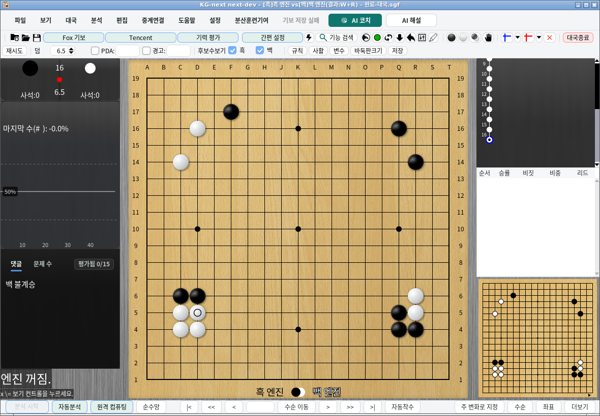
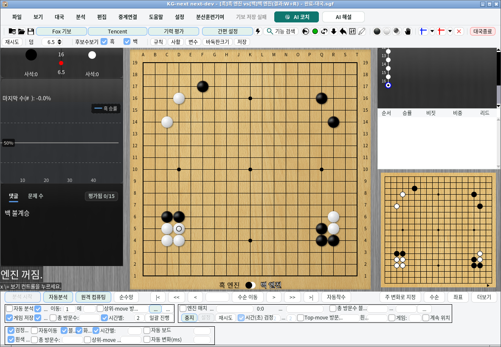

# 기보 저장과 배치 진행의 계약

## 파일 식별자와 표시 순서

`save/save`의 `save-game-index` 값은 `save/game<index>.sgf` 및 `.bmp`의 파일 식별자다.
삭제 후에도 남아 있는 식별자와 파일 경로를 바꾸지 않는다. 화면의 기록 번호는 목록
순서에 따라 계속 1부터 표시되므로 파일 식별자와 다를 수 있다.

기존 연속 번호의 목록과 파일은 그대로 읽는다. 파일을 일괄 이동하는 마이그레이션은
없다. `save-game-next-index`는 다음에 사용할 식별자의 하한을 저장하며, 전체 삭제
후에도 이미 공개된 식별자를 재사용하지 않는다. 해당 키가 없는 기존 목록에서는
현재 최대 식별자로부터 하한을 계산한다.

이전 버전은 목록을 저장할 때 식별자를 다시 연속 번호로 만들 수 있다. 삭제로 번호에
빈 곳이 생긴 작업 폴더를 구버전과 번갈아 편집하지 않는다. 구버전으로 돌아가야 한다면
먼저 작업 폴더 전체를 백업하고 필요한 SGF를 별도 폴더로 내보낸다.

## 이름 변경과 삭제

이름 변경, 개별 삭제, 전체 삭제는 자동·임시 저장과 같은 EDT 작업 순서에 들어간다.
별도의 메타데이터 후보를 만들고 `Config.saveTempBoard(candidate)`로 파일을 원자적으로
교체한 뒤 성공한 후보만 메모리에 공개한다. 이 단계가 실패하면 기존 목록과 기보·
미리보기 파일을 유지하며 저장 실패를 알린다. 이름 변경은 기보와 미리보기를 다시
인코딩하거나 쓰지 않는다.

삭제는 목록 확정 **이후** 삭제된 식별자의 SGF와 BMP만 정리한다. 남아 있는 파일은
이동·덮어쓰기하지 않는다. 원자적 목록 교체와 여러 파일 삭제를 하나의 파일시스템
트랜잭션으로 취급하지 않는다. 정리 도중 실패하거나 프로세스가 종료되면 목록에 없는
파일이 남을 수 있지만, 이미 확정한 목록을 이전 상태로 되돌리지 않는다. 정리 실패는
남은 경로와 함께 로그에 기록한다. 자동 저장 파일과 목록에 없는 파일은 전체 삭제
대상에 포함하지 않는다.

## 새 기록과 실패한 저장의 복구

새 저장은 작업이 실행될 때 식별자를 다시 고른다. 목록의 식별자뿐 아니라 해당 경로에
이미 있는 SGF·BMP·디렉터리·심볼릭 링크도 피한다. 파일 존재 여부를 검사할 수 없으면
빈 슬롯으로 간주하지 않고 실패한다. 따라서 목록 반영에 실패한 이전 저장이나 삭제
정리에 실패해 남은 파일을 새 기록이 조용히 덮어쓰지 않는다.

기존 기록의 명시적인 덮어쓰기는 기존 파일별 원자적 저장 경로를 유지한다. SGF 교체
후 목록 저장이 실패한 경우의 여러 파일 간 crash transaction을 새로 제공하지는 않는다.
남은 SGF는 별도로 열어 확인한 뒤 수동으로 복구할 수 있다.

## 저장 결과와 종료

자동·임시 기보 저장은 SGF와 목록 메타데이터를 모두 저장한 경우에만 `true`를 반환한다.
새 기록의 식별자를 확보하지 못했거나 덮어쓸 기록이 이미 사라진 경우, 이전 자동 저장의
복구가 끝나지 않아 저장을 보류한 경우에는 `false`를 반환한다. 선택 항목인 미리보기
이미지의 저장 실패는 SGF 저장 성공을 취소하지 않는다. EDT 밖에서 호출해도 EDT의
실제 작업이 끝날 때까지 기다리고 동일한 결과를 반환한다.

임시 저장 버튼은 실패 시 현재 목록 화면과 입력을 유지한다. 종료 시 자동 저장이
실패하면 현재 기보와 창을 유지하며 종료를 취소한다. 엔진 및 HumanSL 준비 작업의
종료는 필수 저장 성공을 확인한 뒤에 시작하므로 저장 문제를 해결한 후 다시 시도할 수 있다.

종료 요청 당시 진행 중인 비동기 SGF 저장은 파일 쓰기뿐 아니라 UI의 완료 처리까지
기다린다. 그 저장 중 하나라도 실패하면 해당 종료 요청을 취소한다. 이미 완료되어
실패를 알린 과거 저장은 다음 종료 요청을 계속 차단하지 않는다.

## 배치 분석 결과

일반 배치와 빠른 배치는 현재 기보의 분석 SGF를 저장한 뒤에만 다음 기보를 불러오거나
배치 완료를 알린다. 저장 실패 시 현재 기보, 배치 목록과 현재 위치를 유지하며 분석을
일시 중지한다. 배치 진행 창의 **저장 재시도** 또는 기존 분석 시작 동작으로 같은 결과를
다시 저장한다. 저장 성공 전에는 원본 기보를 다시 불러오거나 다음 기보를 분석하지 않는다.

재시도는 처음 저장하려던 기보·목록·위치와 출력 이름을 유지한다. 사용자가 다른 기보를
열거나 배치 목록을 교체한 뒤에는 이전 재시도가 새 기보를 저장하거나 다음 작업으로
진행시키지 않는다. 수동 중지 후의 저장 재시도는 저장을 마친 뒤에도 다음 파일로 넘어가지 않는다.

빠른 배치의 저장은 엔진 결과 반영과 공유 엔진 반환이 끝난 완료 콜백에서 시작한다.
진행창의 표시나 시간 지연을 완료 근거로 삼지 않는다. 다음 파일의 실제 불러오기가
성공한 뒤에만 배치 위치를 바꾸고, 새 국면의 엔진 동기화가 끝난 뒤 분석을 시작한다.
취소하거나 교체한 작업의 늦은 완료 콜백은 현재 배치를 진행시키지 않는다.

이 계약은 한 KG-next 인스턴스의 저장·편집 작업을 대상으로 한다. 같은 작업 폴더에
여러 프로세스가 동시에 쓰는 경우의 잠금이나, 전원 차단·네트워크 파일시스템의 내구성까지
검증·보장하는 것은 아니다. 저장 I/O의 비동기화 역시 이 변경 범위에 포함하지 않는다.

## 엔진 대국 결과와 저장 재시도

배치 엔진 대국은 종료 SGF와 누적 결과 TXT를 모두 저장한 뒤 다음 대국을 시작한다.
단판은 시작할 때 선택한 자동 저장 설정을 따른다. 선택 항목인 승률 그래프 PNG의
저장 실패는 이미 저장한 SGF의 성공을 취소하지 않는다.

기본 폴더에 저장하지 못하면 기존 시간 이름의 대체 폴더를 시도한다. 필수 파일을
저장하지 못하면 **기보 저장 실패** 상태로 종료 기보와 배치 통계를 유지하며, 다음
대국과 새 배치 시작을 보류한다. 오류 안내에서 실제 실패한 경로를 확인하고 공간·
권한·파일 충돌을 해결한 뒤 기존 대국 조작부의 **재시도**를 누른다. 하단 대국
조작부와 상단 대국 메뉴에서 재시도할 수 있다.

재시도는 같은 대국의 출력 이름과 이미 캡처한 SGF·결과를 사용한다. 승수, 소요 시간,
분석량, 결과 주석은 다시 집계하지 않는다. SGF 저장 후 TXT만 실패했다면 TXT만 다시
저장하며 SGF를 덮어쓰지 않는다. TXT도 SGF와 같이 같은 디렉터리의 임시 파일을 완전히
기록한 뒤 원자적으로 교체하므로 실패한 쓰기로 기존 결과를 잘라내지 않는다.

저장 실패 상태에서 **중지**를 누르면 이후 대국만 취소한다. 미저장 결과와 재시도는
유지되며, 이후 저장이 성공해도 다음 대국을 시작하지 않는다. 다른 기보를 연 경우에도
이전 재시도는 완료한 원래 대국을 저장하고 새 기보를 변경하거나 다음 대국을 시작하지
않는다. 저장이 성공하면 실제 저장 경로를 안내한다.

앱 종료는 미저장 엔진 대국의 필수 파일 저장을 재시도한다. 완료 처리나 저장이 아직
진행 중이거나 저장에 실패하면 창과 기보를 유지하고 종료를 취소한다. 일반 종료 자동
저장 설정을 꺼 두어도 이 확인은 적용된다. 이 재시도 정보는 실행 중인 메모리에
보존되며, 강제 종료 후 다음 실행에서 자동으로 복원하는 기능은 포함하지 않는다.

저장 실패 상태의 한국어 화면이다. 상단 **재시도**와 **대국종료**는 엔진 프로세스가
정리된 뒤에도 사용할 수 있다. 상세 하단 조작부를 펼친 경우에는 같은 동작을 하단의
**재시도**와 **중지**에서도 실행할 수 있다.

