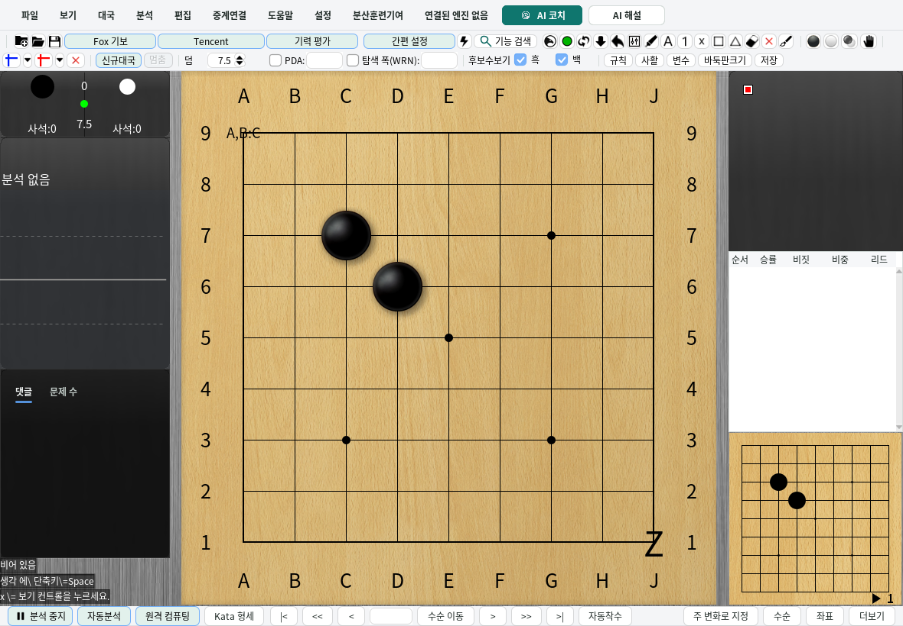
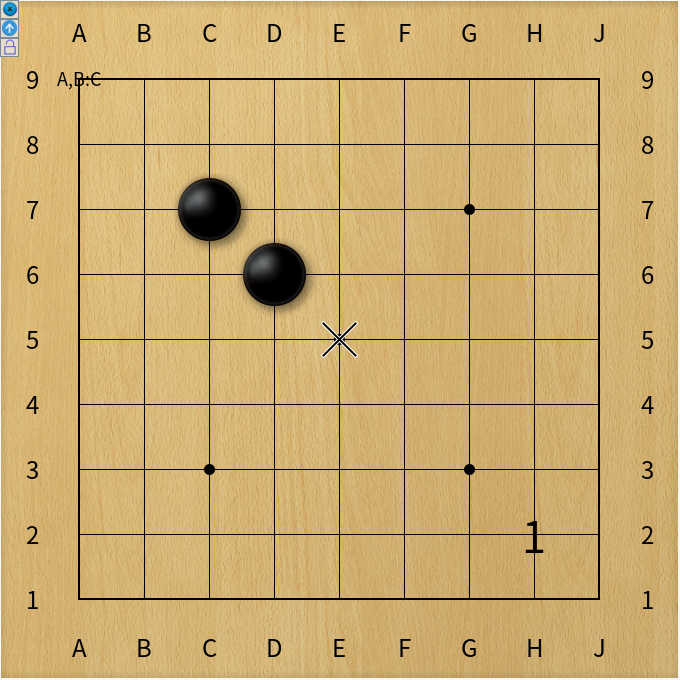

# SGF 속성 값 보존

SGF 속성의 값은 대괄호별로 구분해 읽고 저장한다. 쉼표와 라벨 안의 추가
콜론은 값의 내용이며 구분자로 사용하지 않는다. 예를 들어
`LB[aa:A,B:C][bb:D]`는 두 라벨로 유지되고, `AR[aa:bb][cc:dd]`,
`LN`, `TB`, `TW`, `VW` 및 사용자 정의 속성의 복수 값도 저장 후 다시 읽을 때
순서와 빈 값을 유지한다. 일반 속성의 닫는 대괄호와 백슬래시 이스케이프 표현은
보존하며, 기존 파서의 줄바꿈 해석은 유지한다.

메인 바둑판과 독립 바둑판에서 표식을 추가하거나 지울 때 다른 위치의 라벨은
그대로 남는다. 도구막대의 **표식 전체 지우기**는 기존 편집기가 지원하는
`LB`, `CR`, `SQ`, `MA`, `TR`만 지운다. 배치 좌표, 영역 정보, 화살표,
사용자 정의 속성과 분석 출처 정보는 지우지 않는다. 속성 보존은 해당 속성을
화면에 그리거나 편집하는 기능의 추가를 뜻하지 않는다.

## 구현 계약

- `BoardData`의 일반 속성은 삽입 순서가 있는 `Map<String, List<String>>`으로
  저장한다. 각 목록 항목은 하나의 SGF 값이며 기존 파서가 남긴 이스케이프를
  다시 디코딩하지 않는다. 쉼표를 이용해 값을 합치거나 나누지 않는다.
- 읽어 들이는 값과 추가 표식은 `addProperty`로 추가한다. 프로그램이 갱신하는
  단일 값은 `setProperty`로 교체한다. 단일 값을 해석하는 `getProperty`와
  `getOrDefault`는 마지막 값을 사용하고, 복수 값 소비자는 `getPropertyValues`를
  사용한다.
- 속성 목록은 갱신 시 새 목록으로 교체한다. 노드 복제, 동기화, 저장 및 편집
  스냅샷은 목록도 복사하여 이후 변경이 캡처한 상태를 바꾸지 않게 한다.
- 착수나 배치 속성보다 먼저 나온 일반 메타데이터도 같은 SGF 노드에 귀속한다.
  착수 노드가 생기면 보류된 값을 먼저 적용하여 뒤따르는 같은 키의 값과 순서가
  바뀌지 않게 한다.

기존 게임 정보의 정규화와 댓글·분석 페이로드의 별도 처리는 유지한다. 따라서
원본 파일 전체의 바이트 순서나 공백을 그대로 복제하는 기능은 아니다.
압축 배치 좌표와 분석 출처(`KGP`)의 기존 의미도 유지한다. 과거 파일의
`DD[true]`는 계속 내부 더미 노드로 해석하며, 그 외 `DD` 값은 일반 속성으로
보존한다.

## 회귀 검증

`SGFPropertyValuesTest`는 파일·문자열·편집·독립 파서와 분기 가져오기를 거쳐
반복 저장해도 값 경계, 순서, 빈 값, 이스케이프와 노드 귀속이 유지되는지 검사한다.
기존 압축 좌표, 배치 스냅샷, 분석 출처 및 저장 스냅샷 검사도 함께 실행한다.

`SgfMarkupEditingDesktopTest`는 실제 두 창의 마우스 리스너와 도구막대에서
표식 추가·삭제·전체 지우기를 수행한 뒤 저장·재열기 결과를 검사한다.
이 검사는 `scripts/run_local_ci.py --profile portable --group desktop`에
포함되며 화면이 없거나 검사가 생략되면 desktop 검증을 통과하지 않는다.
실행별 스크린샷과 SGF는 `target/desktop-smoke/probes/sgf-markup-*/`에 남긴다.
