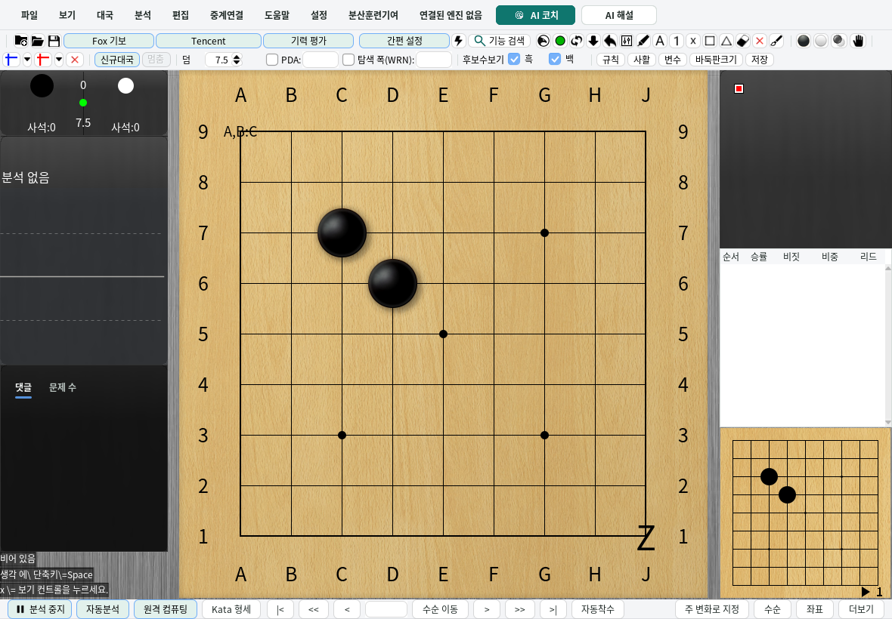
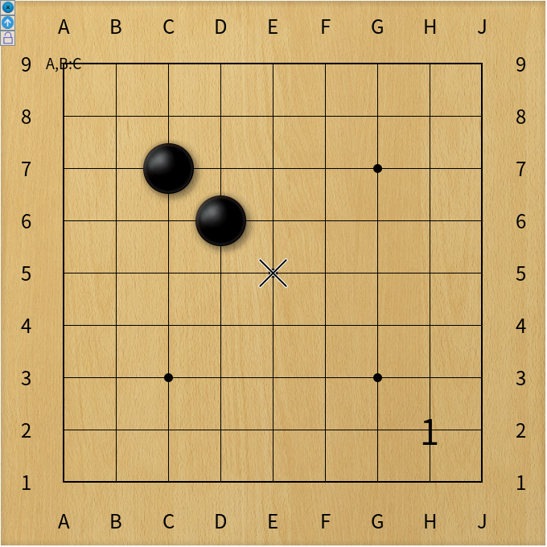

# SGF 속성 값 보존

SGF 속성의 값은 대괄호별로 구분해 읽고 저장한다. 쉼표와 라벨 안의 추가
콜론은 값의 내용이며 구분자로 사용하지 않는다. 예를 들어
`LB[aa:A,B:C][bb:D]`는 두 라벨로 유지되고, `AR[aa:bb][cc:dd]`,
`LN`, `TB`, `TW`, `VW` 및 사용자 정의 속성의 복수 값도 저장 후 다시 읽을 때
순서와 빈 값을 유지한다. 일반 속성의 닫는 대괄호와 백슬래시 이스케이프 표현은
보존하며, 기존 파서의 줄바꿈 해석은 유지한다.

메인 바둑판과 독립 바둑판에서 표식을 추가하거나 지울 때 다른 위치의 라벨은
그대로 남는다. 도구막대의 **표식 전체 지우기**는 기존 편집기가 지원하는
`LB`, `CR`, `SQ`, `MA`, `TR`만 지운다. 배치 좌표, 영역 정보, 화살표,
사용자 정의 속성과 분석 출처 정보는 지우지 않는다. 속성 보존은 해당 속성을
화면에 그리거나 편집하는 기능의 추가를 뜻하지 않는다.

## 구현 계약

- `BoardData`의 일반 속성은 삽입 순서가 있는 `Map<String, List<String>>`으로
  저장한다. 각 목록 항목은 하나의 SGF 값이며 기존 파서가 남긴 이스케이프를
  다시 디코딩하지 않는다. 쉼표를 이용해 값을 합치거나 나누지 않는다.
- 읽어 들이는 값과 추가 표식은 `addProperty`로 추가한다. 프로그램이 갱신하는
  단일 값은 `setProperty`로 교체한다. 단일 값을 해석하는 `getProperty`와
  `getOrDefault`는 마지막 값을 사용하고, 복수 값 소비자는 `getPropertyValues`를
  사용한다.
- 속성 목록은 갱신 시 새 목록으로 교체한다. 노드 복제, 동기화, 저장 및 편집
  스냅샷은 목록도 복사하여 이후 변경이 캡처한 상태를 바꾸지 않게 한다.
- 착수나 배치 속성보다 먼저 나온 일반 메타데이터도 같은 SGF 노드에 귀속한다.
  착수 노드가 생기면 보류된 값을 먼저 적용하여 뒤따르는 같은 키의 값과 순서가
  바뀌지 않게 한다.
  첫 SGF 노드도 같은 규칙을 적용한다. 예를 들어
  `(;SZ[5]LB[aa:A]B[bb]LB[cc:B])`의 두 라벨은 모두 첫 착수에 붙는다.
  댓글, 노드 이름, 수순 번호, 사용자 속성과 분석 데이터도 같은 대상에 적용하며,
  착수가 없는 노드는 노드 경계에서 현재 위치에 적용한다. 바둑판 크기와 규칙·날짜
  등 기보 전역 정보는 내부 루트에 유지한다. 별도의 루트 댓글 저장이나 더미 노드
  사전 탐지 없이 공통 `PendingNodeMetadata`가 적용 시점을 관리한다.

기존 게임 정보의 정규화와 댓글·분석 페이로드의 별도 처리는 유지한다. 따라서
원본 파일 전체의 바이트 순서나 공백을 그대로 복제하는 기능은 아니다.
압축 배치 좌표와 분석 출처(`KGP`)의 기존 의미도 유지한다. 과거 파일의
`DD[true]`는 계속 내부 더미 노드로 해석하며, 그 외 `DD` 값은 일반 속성으로
보존한다.

## 변화도 저장·재열기

KG-next가 작성한 기보를 다시 열면 각 변화도의 순서와 부모 노드를 유지한다.
같은 색이 같은 자리에 두거나 패스하는 형제 변화도도 각각의 댓글과 후속 수를
보존한다. 더미 노드와 배치 노드로 시작하는 변화도도 같은 위치에 함께 남는다.
변화도에서 새로 시작하거나 이어서 표시하는 수순 번호는 사용자의 설정을 따른다.
KG-next 기보에서 점유된 자리에 돌을 두는 등 재현할 수 없는 착수가 나오면,
그 수의 속성과 후속 수순을 건너뛰고 다음 형제 변화도를 원래 부모에서 읽는다.
외부에서 작성했거나 작성 프로그램 표시가 없는 기보에는 공통 착수·패스 수순을
병합하는 기존 가져오기 규칙을 적용한다.

## 시작 배치 편집과 포획 방식

시작돌을 삭제하거나 색을 바꾼 기보는 루트에 `KGCM[KG-next/1][1]`을 기록한다.
마지막 `1`은 시험 빌드에서도 읽을 수 있는 포획 표시다. KG-next가
작성한 이 기보에서는 일반 착수에 바둑의 포획 규칙을 적용하고, 무포획으로 둔
착수에만 `KGNC[1]`을 기록한다. 이 속성은 해당 착수 노드에서만 유효하다.
따라서 옵션을 도중에 바꾼 기보도 편집 당시 돌과 포로 수로 다시 열린다.
버전 표시 도입 전 KG-next 파일의 `KGCM[1]`도 시험 빌드와 같은 의미로 읽는다.
구버전이 외부 속성을 그대로 옮겨 썼다면 같은 값이 생길 수 있으며,
이 경우에도 `KGNC[1]`은 무포획 착수로 해석한다.
다른 프로그램에서 사용한 같은 이름의 속성은 원래 값과 순서를 보존한다.
원래 값이 포획 표시와 겹치면 KG-next는 그 뒤에 실제 포획 표시를 덧붙인다.
예를 들어 외부 기보의 `KGCM[1]`은 저장 시 `KGCM[1][KG-next/plain]`이 되어,
다시 열어도 원래의 `1`을 유지하고 현재 포획 옵션을 적용한다.
표시가 없는 기존 기보는 열 때 선택한 포획 옵션을 사용한다. 혼합 기보의 포획
방식을 복원하려면 이 두 속성을 해석하는 판독기가 필요하다.

ReadBoard가 대국 도중 읽은 시작 국면은 루트의 `AB`, `AW`, `PL`에 돌과 다음
차례를 기록한다. KG-next는 시작 수순, 흑·백이 잡은 돌 수, 마지막 착수 표시,
수순을 아는 돌의 번호도 루트의 `KGRP`에 기록한다. 예를 들어
`KGRP[KG-next/1 42 4 3 Bbb Bbb:42 Wee:20]`은 흑이 네 돌, 백이 세 돌을
잡은 42수 국면이다. 마지막 착수는 `bb`의 흑돌이고, `ee`의 백돌은 20수다.
마지막 착수를 모르면 그 자리에 `-`를 쓴다. 알 수 없는 돌 번호는 생략한다.
배치를 편집한 뒤 저장하면 현재 국면에서 이 값을 다시 만든다.

KG-next는 자체 기보의 첫 배치 노드에서만 이 정보를 복원한다. 값이 잘못되었거나
기록한 돌의 위치·색이 배치와 맞지 않으면 표준 배치에서 시작한다. 이전 파일과
`KGRP`를 해석하지 않는 판독기는 기존처럼 배치 후 첫 착수를 1수로 읽는다.

무포획 착수로 일반 바둑 규칙에서 잡힐 돌이 남으면 그 수와 이어지는 수순의
엔진 분석을 보류한다. 시작 배치 편집으로 활로가 없는 돌무리가 생긴 경우에도
기보에는 돌을 보존하고 KataGo 분석을 보류한다. 편집을 취소하거나 독립적인 배치 노드로 이동한 뒤 엔진이
국면을 확인하면 분석을 재개할 수 있다.

## 덤 저장·재열기

KG-next는 저장 시 게임 정보의 덤을 `KM`에 집 단위로 기록한다. 일반·자동 저장,
문자열 내보내기, 분석 정보 제외 저장과 현재 분기 저장 모두 작성 프로그램을
`AP[KG-next: 버전]`으로 기록한다. 분석 정보 제외 저장에서도 원본 프로그램의
`AP`를 남기지 않으므로 이미 변환된 덤이 원본 형식으로 다시 해석되지 않는다.

루트의 마지막 `AP` 값이 정확히 `KG-next`이거나 `KG-next:`로 시작하면 루트
`KM`을 단위 변환 없이 읽는다. 이전 버전의 일반 저장 파일에도 적용되며,
`7.25`, `-0.25`, `200` 등은 반복 저장·재열기 후에도 같은 값으로 유지된다.
이 경우 구형 별칭 `KO`가 함께 있어도 속성 순서와 무관하게 루트 `KM`이
우선한다. 숫자 유효성 및 바둑판 면적보다 절댓값이 작아야 한다는 검사는 유지한다.

그 밖의 파일은 Fox의 규칙별 변환과 기존 구형 입력 변환을 유지한다.
`KO`만 있는 입력도 기존 별칭 처리 대상이다. 덤 읽기 설정을 끄면 일반 기보의
덤을 무시하고, 배치·접바둑에서는 기보의 덤을 적용하는 기존 정책도 유지한다.
과거 분석 정보 제외 저장으로 원본 `AP`가 남았거나 `AP`가 없는 파일은 외부의
구형 입력과 구별할 수 없으므로 기존 변환 규칙을 적용한다.

## 회귀 검증

`SGFPropertyValuesTest`는 파일·문자열·편집·독립 파서와 분기 가져오기를 거쳐
반복 저장해도 값 경계, 순서, 빈 값, 이스케이프와 노드 귀속이 유지되는지 검사한다.
기존 압축 좌표, 배치 스냅샷, 분석 출처 및 저장 스냅샷 검사도 함께 실행한다.

`SGFKomiRoundTripTest`는 이전 자체 저장, 외부·구형 입력, `KM`/`KO` 순서,
덤 읽기 설정과 유효성 검사를 함께 확인한다. 각 저장 모드의 출력을 파일·문자열·
편집·독립 파서로 다시 읽고 반복 저장하여 덤이 유지되는지 검사한다.

`SGFParserSemanticRoundTripTest`는 편집한 기보를 저장한 뒤 동일한 착수·패스의
형제 변화도와 각 댓글·후속 수가 파일·편집·독립 파서에서 유지되는지 검사한다.
더미 노드 다음에 저장된 형제 배치 노드와 변화도 수순 번호 설정도 함께 검사한다.

`SgfMarkupEditingDesktopTest`는 실제 두 창의 마우스 리스너와 도구막대에서
표식 추가·삭제·전체 지우기를 수행한 뒤 저장·재열기 결과를 검사한다.
이 검사는 `scripts/run_local_ci.py --profile portable --group desktop`에
포함되며 화면이 없거나 검사가 생략되면 desktop 검증을 통과하지 않는다.
실행별 스크린샷과 SGF는 `target/desktop-smoke/probes/sgf-markup-*/`에 남긴다.
