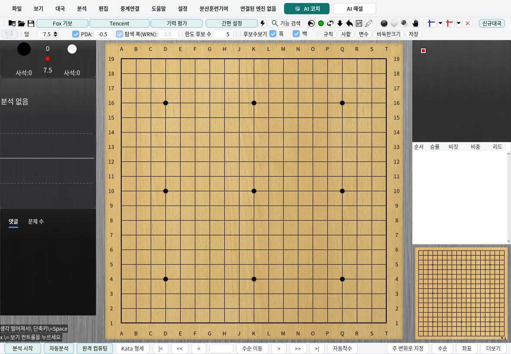
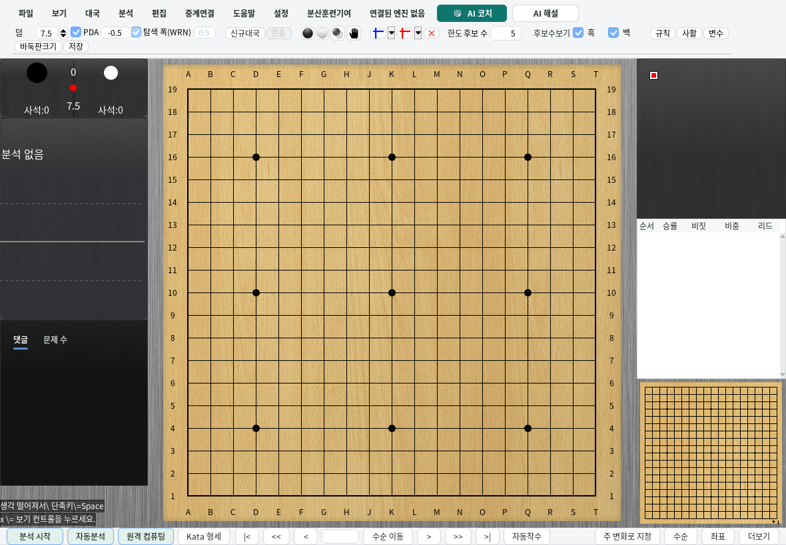
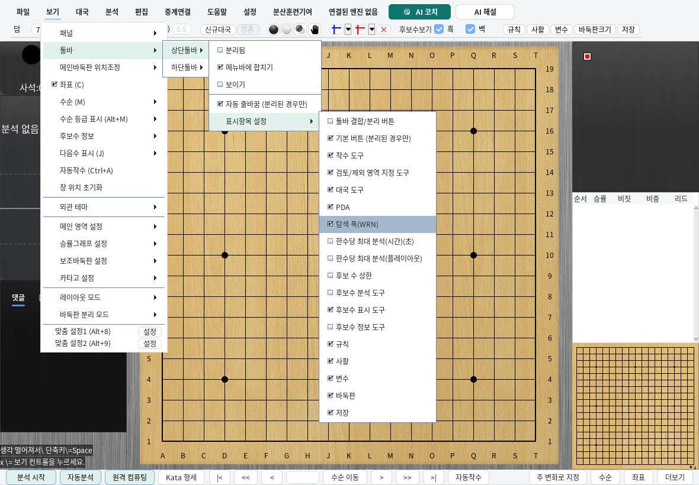
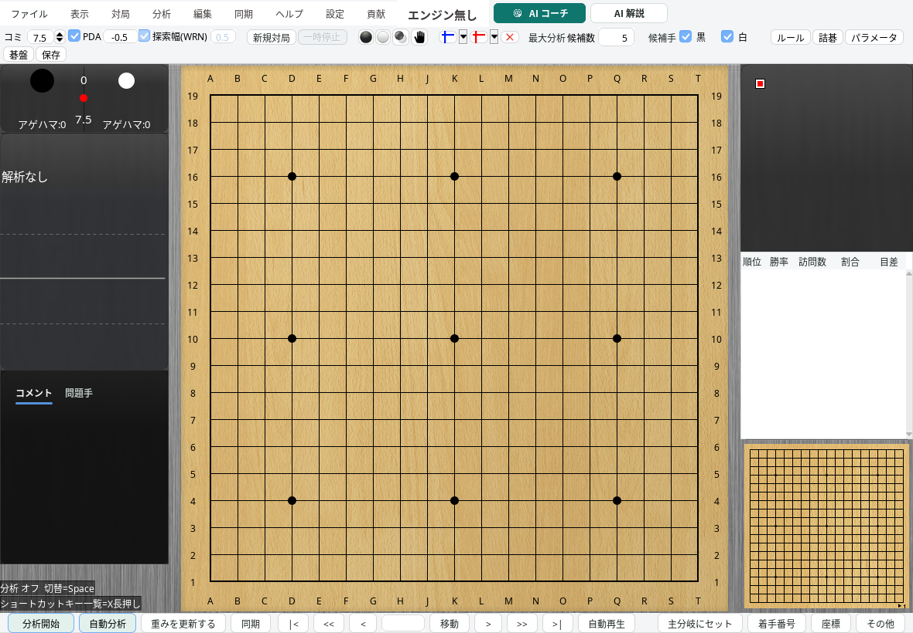
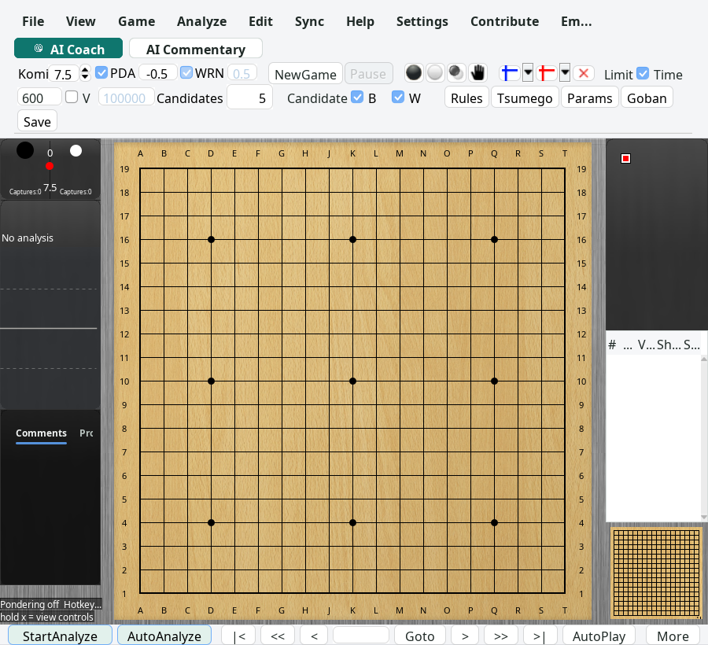

# Toolbar settings

Open **View → Toolbar → Top toolbar → Customize toolbar** to show or hide the
PDA and search breadth (WRN) fields independently. These switches use the same
preferences as the existing engine parameter dialog. Changing their visibility
keeps the parameter values and current analysis intact. The fields still follow
the existing engine and game availability rules.

The same menu offers **Candidate display limit**, which is hidden by default.
Enable it to edit the maximum number of candidate moves displayed on the board:

- A positive integer limits the displayed candidates.
- `0` displays all available candidates, subject to the other existing display
  filters.
- An empty or invalid draft keeps the last valid value.

This field changes the existing display setting. It does not change the engine's
search budget or discard analysis results. The analysis settings dialog and the
toolbar share the same value; saving a change in the dialog updates the toolbar.
Toolbar preferences and the limit use the application's existing save lifecycle.

Both the combined and separated layouts contain the new controls. The candidate
label and its editor remain together when either toolbar wraps. Korean
labels now read **탐색 폭(WRN)** and Japanese labels read **探索幅(WRN)**, including
the generated SGF analysis comments. The combined layout sizes the WRN label from
its rendered text. Its original controls are attached to the active menu surface;
its controls wrap to the available window width, and menu rows reserve their full
height above the board. The combined panel is removed when returning to the
separated layout.

## Find the controls

Function search distinguishes the visibility switches from the candidate value
editor. In Korean, for example:

| Search | Destination |
| --- | --- |
| `도구막대 PDA 숨기기` | PDA visibility option in toolbar customization |
| `도구막대 WRN 표시` | WRN visibility option in toolbar customization |
| `도구막대 후보 수 상한 표시` | Candidate-limit visibility option |
| `후보 수 개수` | Candidate-limit editor on the toolbar |

Selecting a search result locates the original control without changing its
value. Locating a hidden candidate editor reveals it for the current session;
explicitly choosing its visibility option records the preference.

## Verification

The focused unit tests cover independent visibility preferences, input validation,
save/reload, settings synchronization, accessible labels, translated widths and
search destinations. Existing KataGo input and engine-switch tests guard the
parameter ownership paths used by both layouts.

Run the real Swing-window checks on an operational desktop:

```sh
mvn -B -Dfmt.skip=true -Djava.awt.headless=false -Dlizzie.desktop.required=true \
  -Dtest=ToolbarSettingsDesktopTest,FunctionSearchNavigationTest,ConfigDialog2NavigationTest test
```

The toolbar probe exercises Korean, Japanese and English, both layouts, independent
hide/show actions, zero and positive limits, function search, and saving through the
actual settings dialog. It checks that display edits preserve recorded analysis and
send no engine commands. Korean and English use the custom menu strip; Japanese
uses the native Swing menu bar. Korean runs at a configured UI scale of 1.5;
Japanese and English run at 1. English uses the medium application font and also
checks the restored game popup and settings buttons. All three probes also narrow
the window with time and visit limits enabled and verify that every settings
button and limit editor stays inside the window and above the board. All three
invocations are required by the desktop CI runner.
The probe uses a recording engine double; it does not benchmark or launch KataGo.

Screenshots are captured from the production window under
`target/desktop-smoke/probes/toolbar-settings-*`.

### Separated toolbar



### Combined toolbar



### Toolbar customization menu



### Native Swing menu



### Narrow window with medium fonts


