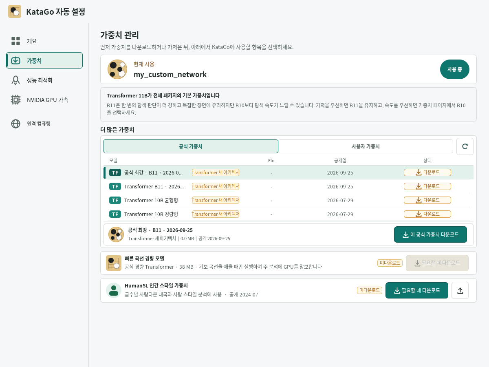
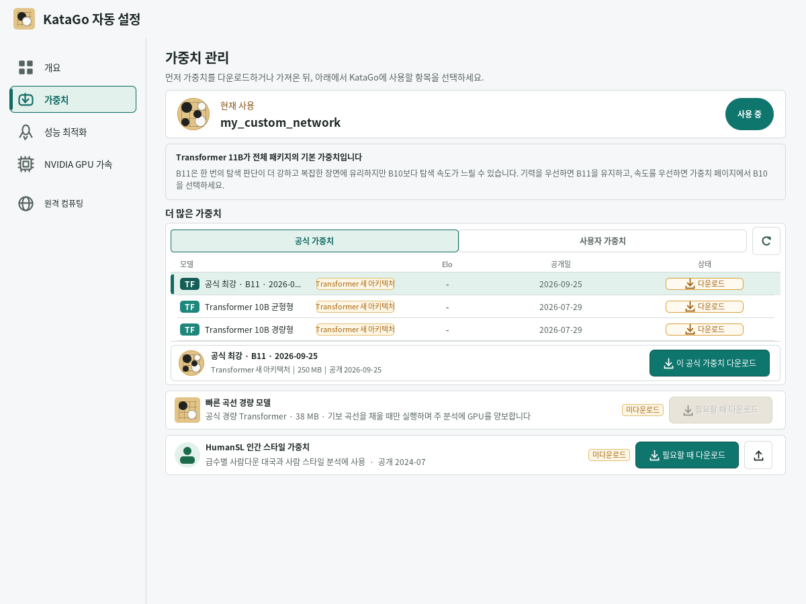

# Optional official strongest model with same-origin integrity metadata

The official weight list reads the network currently identified by
`https://katagotraining.org/api/networks/get_strongest/`. A valid response adds an
“Official strongest” row, or marks the existing pinned row when the file matches.
Users choose whether to download it and then explicitly apply the downloaded model.

This dynamic row uses the size and SHA-256 from the same official API. These values
detect corruption and truncation, but do not protect against compromise of the
official service. The three catalog models retain their release-pinned hashes in
`katago-assets.json`; legacy HTML table choices retain their existing behavior.

## Considered Options

- Pin every strongest response in the release catalog: this requires a release each
  time the official choice changes and does not provide dynamic discovery.
- Accept the official model without integrity metadata: rejected because the API
  supplies both size and SHA-256, which the existing downloader can verify.
- Follow the strongest model for bundled assets or default selection: rejected
  because releases and user engine profiles must remain reproducible.

## Consequences

- Opening or refreshing the list does not install a model, switch an engine, or
  write a user profile. Existing selections are preserved. With no matching
  selection, the current model and then the catalog default remain preferred.
  Recommendation cards, packaged assets, and automatic setup retain catalog policy.
- Metadata must arrive directly from the API with a successful 2xx response;
  redirects are rejected. `lizzie.katago.strongest.url` is a test override, like the
  existing `lizzie.katago.networks.url` property.
- The model URL must exactly equal
  `https://media.katagotraining.org/uploaded/networks/models/kata1/<name>.bin.gz`.
  The response must include a positive integral byte count, a SHA-256 string, and
  a valid creation date. The downloader rejects a size or hash mismatch before
  publishing the model. For a matching catalog file, pinned integrity and identity
  take precedence over API metadata.
- Recognized `kata1-tf*` Transformer names require KataGo 1.17.0; recognized classic
  `kata1-b<N>c<N>-` networks have no additional version requirement. Unsupported
  names are treated as a failed lookup.
- Lookup failure or invalid metadata removes the dynamic strongest row. The pinned
  catalog remains available, and no previous strongest response is cached on disk.
- The “Official strongest” label belongs only to the online catalog row.
  Downloaded model display and engine profile names retain their existing policy,
  including the full model name for uncatalogued trained Transformers.

The implementation selectively ports upstream commit
`7071319ac2d3403e1ba7415ca32796fa95f15d40`, while preserving KG-next's catalog and
user profile handling.

## UI evidence

`OfficialStrongestModelDesktopTest` runs the production dialog in Linux/Xvfb with
a local HTTP fixture. Its refresh button exercises the asynchronous request and
EDT update. It checks explicit row selection, a failed subsequent response, a
matching pinned model, and unchanged in-memory and saved user settings.

The screenshots below were captured from KG-next. The first uses a synthetic
new model with a 1,000-byte metadata fixture; no model is downloaded. The second
matches the pinned model and demonstrates that its 250 MB catalog size takes
precedence over fixture metadata. Neither screen is an engine-performance test.

