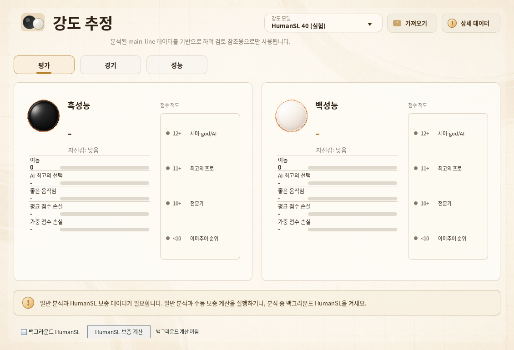

# HumanSL 40 strength assessment

## Current Workflow

Open a normally analyzed SGF and select **HumanSL 40** in the existing
player-strength model dropdown. Both player estimates, matching statistics,
performance charts, and detailed data remain in the original dashboard.
`xgboost20tun` remains the default; the separate HumanSL game mode is unchanged.
**XGBoost 20TUN Previous**, its bundled booster/calibrator, and imported models
remain available. HumanSL 40 is labeled **experimental** in the model selector.



This UI screenshot uses a synthetic demonstration game and synthetic cached
ordinary analysis, not a private game or model-accuracy benchmark.

Selecting the model **never starts an engine, download prompt or progress dialog**.
Use **Run HumanSL supplement** to explicitly open progress and prepare missing
data. Completed background data are displayed without a progress window.
The **Background HumanSL** checkbox is off by default and persisted in user settings;
enable it explicitly if spare local GPU capacity is available.
While ordinary foreground pondering or game analysis is active, the background
queue silently prefetches all main-line HumanSL policies, including moves after
210. The 40-feature estimator still uses only the first 210 moves and current
ordinary analysis; prefetching a whole game does not change that model contract.

Background work uses at most four concurrent positions, each with a single
search thread, enabling KataGo cross-position batching. It does not load an
ordinary judge or repeat ordinary searches. Manual and background work share a
single-owner queue: manual work retires the background attempt, waits for its
worker to close, then resumes missing cache entries. Changing games/rules,
disabling the checkbox, pausing ordinary analysis, entering a reserved game or
engine task, or closing the app cancels
background work and retains completed private cache entries. Turning background
off does not cancel an explicitly requested manual job. Normal foreground
completion permits an already-started background batch to finish. A failed
attempt is not retried every UI tick; manual retry or re-enabling the checkbox
re-arms it. Background failures and missing weights are status-only: download
confirmation occurs only through the explicit button. Enabling this option
does not guarantee that two GPU workloads have zero contention.

There is no judge selection, model-path form, separate assessment table, or
second ordinary whole-game analysis. The assessment captures the current
primary analysis on the main line, capped at the first 210 moves, including
candidate order/prior/score/winrate, root score and winrate. Reported moves and
winrate losses are derived from the same frozen data, without a second read of
the live board or a separate 20TUN inference. Scores are normalized to
side-to-move perspective. Current analysis rules and normalized game komi are
reused, not reinterpreted from raw SGF properties. Each side needs at least six
valid moves with candidates before the move and root estimates on both sides
of the move. Missing positions are skipped, never automatically searched.
Handicap, setup/edit, nonalternating histories and non-19x19 games are not yet
validated and are rejected.

Only missing HumanSL policies are obtained from a supplementary local process.
Every profile (1d, 5d, 9d) uses **maxVisits=1**, history enabled, two root
symmetries, and zero weightless human exploration. The last post-move position
needs no human policy. The supplemental process's scores, winrates and
candidates are discarded. It cannot publish into board analysis or change the
normal engine/configuration. Cancel, close or Escape in the explicit progress
dialog stops its manual job; closing the dashboard leaves background work alone. A
game/history/rules change invalidates the captured result.

The local KataGo executable and fixed HumanSL weight are discovered automatically.
HumanSL 40 finds its required network by size and SHA-256 independently of the
custom model selected for HumanSL games. Renamed or imported copies with the
same verified contents can be reused, including an explicitly selected file
outside the model directories. Installing or reusing this fixed network for
HumanSL 40 preserves the custom HumanSL game model selection.
Manual preparation opens its progress dialog before scanning files or checking
SHA-256 in the background. Cancel or closing the dialog retires that request;
a late scan cannot open a download prompt or start computation.
If the weight is missing, the manual button asks to download it (about 99 MB) via the
existing validated downloader, which supports cancellation. No standard judge
network is needed: the supplement uses the verified human network itself as
its main network. A missing local executable is reported with the existing
engine setup/download route, rather than asking for an analysis command here.

## Model And Features

The bundled teacher-label XGBoost booster has 40 features. The upstream author
reports fitting it on 105 Zhangqi games / 210 sides. It does not attach `xgboost20tun`'s residual
calibrator, soft gate, heuristic tail-loss rank cap, or legacy uncertainty.
Predictions are bounded to [0,12]. The reported teacher cohort has only seven sides below 5d: low-rank and
long-term player strength are not validated. The private training games,
teacher labels, and four private reference fixtures are not in the public
repository; KG has not independently retrained the model or verified those
accuracy claims.

Features comprise 20 standard matching/loss/difficulty/phase features, 8 robust
loss/extreme-position features, and 12 HumanSL surprisal/difficulty/coverage
features across the three profiles. Strict first choice, feature ordering,
training rounding, phase fallback, and acceptable-loss thresholds are retained.
Coverage below 90% leaves that position's HumanSL difficulty missing, not zero.
The detail view's **HumanSL 9d difficulty** is the percentage average over
reliably covered positions; **coverage** is mean searched human probability
mass, not a confidence interval or tactical correctness guarantee. An absent
reliable difficulty displays `-`. Segment reports use the same enriched move
records and 40-feature scorer, with at least six samples per segment.

### Training Versus Reused Analysis

Reference training used KataGo 1.18.2 and
`kata1-b18c384nbt-s9996604416-d4316597426.bin.gz`, with a 5d/maxVisits=500
base query and 50% weightless human exploration. Separate 1d/9d policy probes
used one visit. The production workflow now deliberately reuses the user's
current ordinary analysis instead of enforcing or rerunning that judge search.
Different engines, visits, candidate breadth and evaluation biases can change
the features. In particular, ordinary search may cover less human probability
mass, making more difficulty values missing. Consequently reference-case
predictions/validation accuracy cannot be promised for arbitrary reused
analysis. The dashboard identifies the estimate as experimental.

Human network: `b18c384nbt-humanv0.bin.gz`, SHA256
`637746e44f0efe00ad1245a50aa9bbf0716efe364c43965ead97bd6835d84ab5`.
The weights are verified before inference through the existing HumanSL model
installation and checksum path. The bundled booster SHA256 is
`62e0634f4b028f081c1e40ad06bda1d14fbc6486ca75bb37436b9d4e8623be19`;
it is XGBoost 3.2.0 JSON with 400 trees and the `reg:absoluteerror` objective.
The large public HumanSL network is not bundled. Selecting this estimator does
not change the configured ordinary engine or model.

KG uses float32 features, split thresholds, leaves, and per-tree accumulation
for this new uncalibrated scorer, matching the native XGBoost inference format.
The existing 20TUN scoring and calibration arithmetic remain unchanged.

## Cache And Privacy

Policies and logs live in `~/.lizzie/strength-humansl40-policy-cache`, outside
Git. Policy keys include canonical history, rules, komi, initial player,
profile, all query controls, recipe version, the actual executed binary and
configuration hashes, final command overrides, and human network hash. A
TensorRT installation uses its resolved HumanSL companion's identity, so
updating that companion invalidates its previous policy cache even if the
original TensorRT executable is unchanged. The runner starts that same prepared
command and retains the existing runtime preflight and repair checks.
Only complete normalized policy data are cached. Error, warning,
partial and invalid responses are rejected. Cached policies can be reused when
ordinary analysis improves; predictions and coverage are always recomputed
from the newly captured candidates. A complete cache replay does not start an
engine. User SGFs, runtime query results and engine logs remain local; the
feature performs no uploads or Git operations. The checked-in test vectors and
documentation screenshots are synthetic development fixtures, not user games
or the private training corpus.

## Verification

```sh
mvn -Dfmt.skip -Dtest='*Strength*Test,HumanSlAnalysisRunnerTest,AnalysisRequestBuilderTest' test
```

`HumanSlStrengthReuseSessionTest` covers policy-only budgets, zero ordinary
queries, cache reuse and komi isolation, missing-position skipping, unchanged
analysis, perspective conversion, cancellation, invalid responses, unsupported
handicap metadata, dropdown availability, and report/segment consistency.
`HumanSlStrengthPreparationTest` checks opt-in settings, deduplication,
background/manual ownership, cancellation, and worker shutdown. It also checks
fixed-network discovery alongside a selected custom model, renamed/imported
copies, rejection of corrupt candidates, and the missing fixed-network state.
`HumanSlFixedModelInstallationTest` covers custom-selection presence/absence,
missing/valid/corrupt fixed networks, installation, reuse, repair, HTTP/checksum
failures, and cancellation. It checks the saved settings and existing model
contents as well as the in-memory selection and partial-file cleanup.
`HumanSlStrength40OracleTest` compares the Java scorer with checked-in synthetic
input/output pairs generated by official XGBoost 3.2.0, including threshold
boundaries and missing features. See the
[oracle fixture instructions](../../src/test/resources/models/strength/humansl40-oracle/README.md).
This verifies inference arithmetic, not skill-estimation accuracy.

`HumanSlStrengthDialogTest` starts the real application in isolated child JVMs.
It checks model selection without computation, background preference persistence
across restart, tab preservation while analysis refreshes, and the actual
progress dialog's completion, Cancel, Escape, window close, and changed-game
rejection. A local HTTP fixture verifies that installation and reuse preserve
the custom HumanSL selection and download the fixed network only once.
The production consent dialog is exercised for approval, refusal, and window
close. Additional probes hold discovery or an HTTP response open to verify EDT
responsiveness and cancellation, and check that acquisition failures preserve
the custom selection without starting computation.
The manual worker is controlled synthetic computation. Screenshots
and process evidence are written to the existing desktop probe directory.
The optional `HumanSlStrengthReuseLiveProbe` checks the policy protocol and
owned-process lifecycle with a real engine and a synthetic twelve-move fixture.
The full 500-visit reference reanalysis runner is not shipped in KG.

### Explicit real CPU verification

On Linux, prepare the catalog-pinned Eigen executable and the verified HumanSL
network before running the probe. This command does not download them. Use a
new output directory for each run; existing output is rejected so old cache
entries cannot disguise whether the first pass executed the real engine.

```sh
mvn -B -DskipTests test-compile dependency:build-classpath \
  -Dmdep.outputFile=target/test-classpath.txt
java -Djava.awt.headless=true \
  -cp "target/test-classes:target/classes:$(cat target/test-classpath.txt)" \
  featurecat.lizzie.analysis.HumanSlStrengthReuseLiveProbe \
  /absolute/path/b18c384nbt-humanv0.bin.gz /absolute/path/katago \
  target/humansl40-live
```

The probe requires 36 actual policy queries (12 positions × 3 profiles) with
one visit each, then forbids engine queries during an exact cache replay.
It checks finite predictions for six synthetic moves per side, unchanged
input analysis, and termination of the owned process and reader. Its JSON
evidence records the actual engine, human network and booster hashes. The
four-position concurrency value is the configured upper bound, not a
throughput measurement. This verifies the CPU policy protocol and resource
cleanup; it does not establish game-strength accuracy or GPU behavior.

## Source and scope

This is a selective port of upstream
[`d3937089`](https://github.com/wimi321/lizzieyzy-next/commit/d3937089c5e24a7b3e86547eaa5f0a2791e6fa43)
and its opt-in/Windows-path follow-up
[`42a4852d`](https://github.com/wimi321/lizzieyzy-next/commit/42a4852d2ff933779c451e097ee02ef02996a7df),
using the upstream main snapshot
`cb53acc55eda42c6c671b5f668cd3b597456bf07`.
The training scope and recipe above are the
[upstream author's report](https://github.com/wimi321/lizzieyzy-next/blob/cb53acc55eda42c6c671b5f668cd3b597456bf07/docs/cookbook/humansl40-strength.md).
KG preserves its verified HumanSL companion launch checks and existing strength
models. Optional background preparation is off by default; it does not capture
whole-game snapshots on the periodic UI tick until enabled or manually used.

Protocol reference: [KataGo Human SL analysis guide](https://github.com/lightvector/KataGo/blob/master/docs/Analysis_Engine.md#human-sl-analysis-guide).
